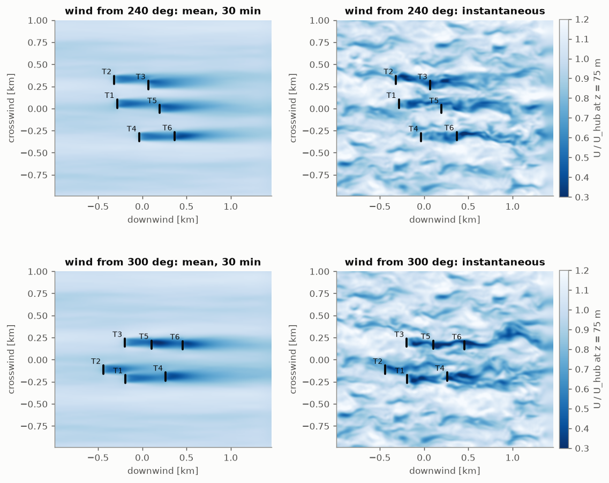
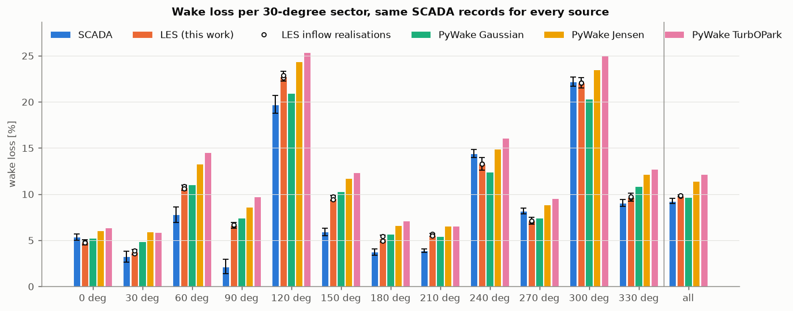
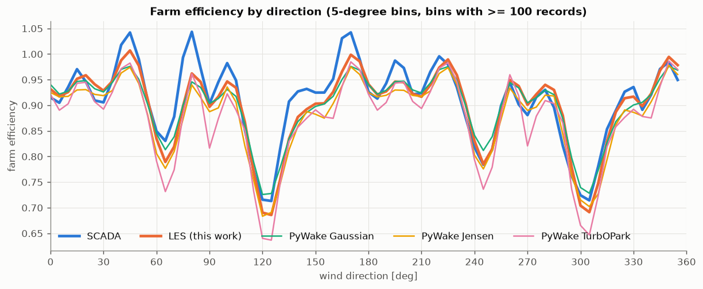
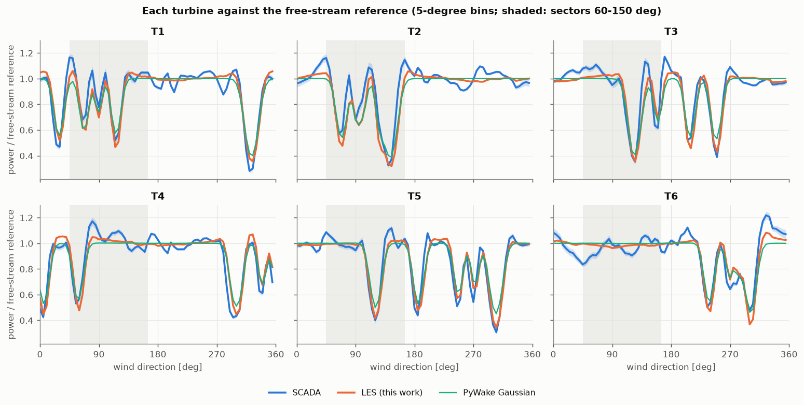
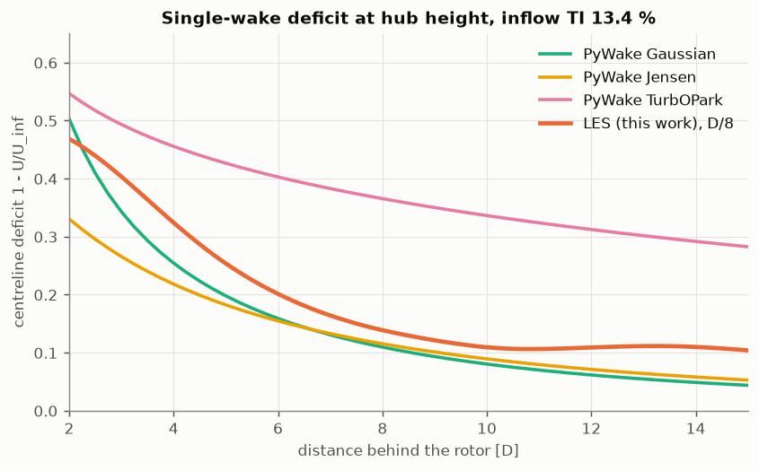
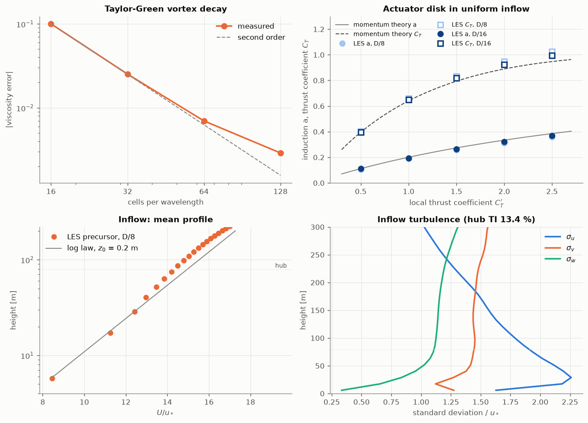
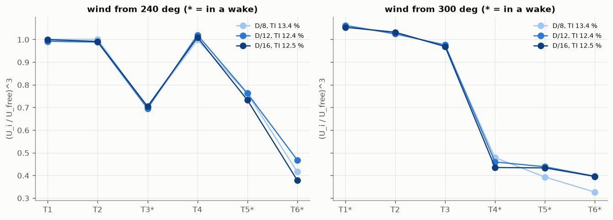
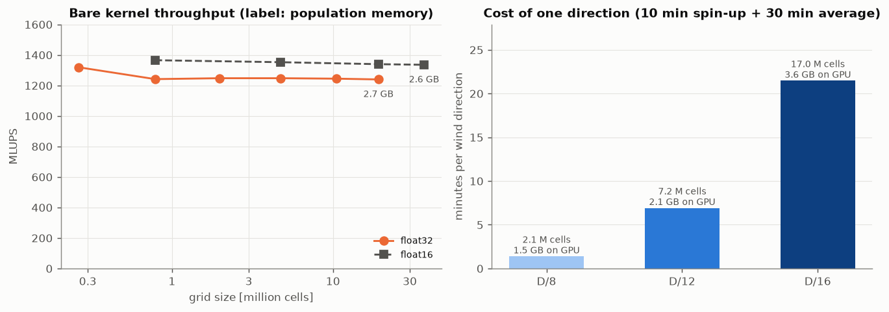

# Kelmarsh wind farm in a laptop-GPU LES

[](https://github.com/kwwaleszczynski-del/wind-les-gpu/actions/workflows/ci.yml)

A **home-made lattice Boltzmann large-eddy simulation** of the open **Kelmarsh wind farm** (UK, 6 x Senvion
MM92) that runs on a 6 GB laptop GPU (Quadro RTX 3000). The solver is one ~550-line module of
[NVIDIA Warp](https://github.com/NVIDIA/warp) kernels: D3Q19, regularized collision, Smagorinsky subgrid model,
a log-law wall model, actuator disks and a periodic precursor for the inflow turbulence. The same kernels compile
for the CPU, which is how the tests run in CI.

The six turbines are simulated for 72 wind directions (every 5 degrees), and the wake loss per 30-degree sector is
compared with two references **on exactly the same 10-minute records**: the measured SCADA (with its uncertainty)
and three engineering wake models in PyWake. It closes a series on the same farm:
engineering models against SCADA in [wind-wake-shadow](https://github.com/kwwaleszczynski-del/wind-wake-shadow),
wake-aware performance checks in
[wind-wake-aware-verification](https://github.com/kwwaleszczynski-del/wind-wake-aware-verification), and now CFD.

**Live page with the hub-height flow animation:** https://kwwaleszczynski-del.github.io/wind-les-gpu/

## Key results

Wake loss on 159 289 SCADA records (1 913 days, 2016-2021, all six turbines in partial load, free-stream reference
speed 5-10 m/s). Every source is evaluated on the same records and normalised the same way.

| Sector | Records | SCADA [95 % CI] | **LES** ± 2 SE | LES realisations | PyWake Gaussian | PyWake Jensen | PyWake TurbOPark |
|---|---|---|---|---|---|---|---|
| 0° | 7 120 | 5.4 [5.0-5.7] | **4.8** ± 0.3 | 4.8 / 4.7 | 5.2 | 6.0 | 6.4 |
| 30° | 10 791 | 3.3 [2.7-3.8] | **3.7** ± 0.3 | 3.6 / 3.9 | 4.9 | 6.0 | 5.8 |
| 60° | 7 733 | 7.8 [6.9-8.6] | **10.7** ± 0.3 | 10.8 / 10.6 | 11.0 | 13.3 | 14.5 |
| 90° | 6 041 | 2.1 [1.4-2.9] | **6.6** ± 0.3 | 6.6 / 6.7 | 7.4 | 8.6 | 9.8 |
| 120° | 4 622 | 19.7 [18.8-20.7] | **22.8** ± 0.5 | 22.7 / 22.9 | 20.9 | 24.4 | 25.4 |
| 150° | 6 606 | 5.9 [5.5-6.3] | **9.6** ± 0.3 | 9.7 / 9.4 | 10.3 | 11.7 | 12.3 |
| 180° | 14 731 | 3.7 [3.4-4.1] | **5.2** ± 0.4 | 4.9 / 5.4 | 5.7 | 6.6 | 7.1 |
| 210° | 28 137 | 3.9 [3.7-4.1] | **5.6** ± 0.2 | 5.7 / 5.5 | 5.4 | 6.5 | 6.5 |
| 240° | 29 728 | 14.4 [14.0-14.8] | **13.3** ± 0.7 | 13.3 / 13.3 | 12.4 | 14.9 | 16.1 |
| 270° | 19 019 | 8.2 [7.9-8.5] | **7.1** ± 0.4 | 7.1 / 7.1 | 7.4 | 8.9 | 9.5 |
| 300° | 16 219 | 22.2 [21.7-22.7] | **22.1** ± 0.6 | 22.1 / 22.1 | 20.3 | 23.5 | 25.0 |
| 330° | 8 542 | 9.0 [8.7-9.4] | **9.7** ± 0.4 | 9.6 / 9.8 | 10.9 | 12.2 | 12.7 |
| **all** | 159 289 | **9.24** [8.98-9.52] | **9.81** ± 0.11 | 9.79 / 9.83 | 9.69 | 11.44 | 12.13 |
| RMSE over sectors vs SCADA | | | **2.2 pp** | 2.2 / 2.2 pp | 2.6 pp | 3.7 pp | 4.4 pp |
| mean bias vs SCADA | | | **+1.3 pp** | +1.3 / +1.3 pp | +1.4 pp | +3.1 pp | +3.8 pp |

- **The LES lands where the best engineering model lands, without a wake parameter fitted to the losses.** Farm
  loss 9.8 % against 9.2 % measured (Gaussian 9.7 %). Per sector it has the lowest error of the four (RMSE 2.2
  percentage points against 2.6 for the Gaussian model); Jensen and TurbOPark overpredict almost everywhere. The
  LES inputs are a roughness length, a thrust coefficient and the turbine positions, and the first two are chosen,
  not measured: $`z_0`$ = 0.2 m was picked so that the hub-height turbulence intensity is close to the SCADA
  ambient 12.7 % (which sets the wake recovery), and $`C_T'`$ is calibrated per grid resolution so that an
  isolated disk gives $`C_T`$ = 0.8 from a generic thrust curve. Neither is fitted to the measured wake losses.
- **A second, independent inflow realisation gives the same answer.** Farm loss 9.79 and 9.83 %, every sector
  within 0.5 points (root mean square 0.24), the same RMSE and bias against the SCADA. The scatter of the
  10-minute blocks within one realisation predicts a larger difference (0.44 points), so the whiskers, ± 2
  standard errors of all six blocks, are not optimistic: 0.2-0.7 points per sector, 0.1 on the farm loss.
- **The deep-wake sectors are reproduced.** Along the row T3-T5-T6 (300°) the LES gives 22.1 % against 22.2 %
  measured, where the Gaussian model is 1.9 points low and Jensen/TurbOPark 1.3-2.8 points high; at 240°, the
  most frequent sector, it is 1.1 points low.
- **Every model overpredicts the easterly sectors (60-150°), and the turbines show why: the reference, not the
  wakes.** The measured loss is lower than in every simulation in all four sectors, by 2.9-4.5 points for the
  LES. Split per turbine, most of it is T2 (+11.3 points of turbine loss in the LES, averaged over the four
  sectors) and T1 (+5.4); the other four are within 2.4. The wake minima agree (T2 at 140°: 0.33 measured,
  0.34 LES); what differs is the level outside the wakes. Unwaked in easterly winds, T2 and T3 produce 6 and 5 %
  more than the free-stream reference and T6 6 % less, while in westerly winds T1-T5 are within 1 % of it.
  T6 is a reference turbine in every easterly direction, so the reference itself is low there and the measured
  losses come out small. A direction-dependent site effect like this is absent from flat-terrain models and
  survives one site factor per turbine (T6 is 6 % low in easterly and 7 % high in westerly winds; its factor
  averages the two).
- **A 30-minute LES mean is not a uniform inflow.** Streaks in the boundary layer leave the mean hub-height speed
  varying from 0.89 to 1.07 of its average across the domain (sd 3.6 %; 0.90-1.03 and 2.3 % in the second
  realisation). Referring every turbine to the farm-wide inflow turned this into ±15 % of power and negative
  "wake losses" in some sectors; referring each one to the same position in the run without turbines brings the
  free-stream turbines to 0.997 ± 0.013 of their own inflow (219 turbine-directions; 0.998 ± 0.013 in the
  second realisation).
- **Cost: 81 s of laptop GPU per wind direction**, 1.7 GPU-hours for all 72 directions, at about
  920 MLUPS for the coupled farm + precursor (2.1 million cells, 35 000 time steps of 0.069 s) and under
  1.5 GB of GPU memory; the second realisation costs the same again. The bare kernel runs at 1240-1320 MLUPS up
  to 19 million cells (2.7 GB, float32).
- **Finer grids move the wake loss by about one point, without a trend.** For the two deepest-wake directions
  (one direction each, at 8 m/s) the farm loss is 19.5 / 18.5 / 20.5 % at 240° and 30.5 / 28.8 / 29.6 % at
  300° with 8 / 12 / 16 cells per rotor diameter: one to two standard errors of the 10-minute blocks. Each
  resolution has its own precursor and so its own turbulence realisation, which limits what the study can
  resolve to about one point. The same 72-direction sweep at D/16 would take 26 GPU-hours instead of 1.7.



*Streamwise speed at hub height for the two directions with the deepest wakes: 30-minute mean (left) and an
instantaneous field (right). The page linked above animates the instantaneous field.*



*Wake loss per sector. Whiskers: SCADA 95 % day-bootstrap interval; LES ± 2 standard errors of its six
10-minute blocks from two inflow realisations. Circles: the two realisations on their own.*



*Farm efficiency in 5-degree bins. The measured curve rises above 1 in a few directions (site effects that the
site factors only partly remove); at 60-80° and 130-160° every model, the LES included, stays below the
measurement.*



*Each turbine against the free-stream reference (SCADA with its 95 % interval over days). The LES follows the
measured wake minima; in the shaded easterly sectors the measured turbines sit further above or below 1
outside the wakes than in any model.*

| Unwaked turbine / free-stream reference | T1 | T2 | T3 | T4 | T5 | T6 |
|---|---|---|---|---|---|---|
| SCADA, easterly winds (0-175°) | 1.01 | **1.06** | **1.05** | 1.03 | 1.02 | **0.94** |
| SCADA, westerly winds (180-355°) | 1.01 | 1.00 | 1.00 | 1.00 | 1.00 | **1.07** |
| LES, easterly winds | 1.02 | 1.03 | 1.02 | 1.02 | 1.00 | 1.00 |
| LES, westerly winds | 1.01 | 1.00 | 1.01 | 1.00 | 1.02 | 1.02 |

*5-degree bins in which neither the LES nor the Gaussian model sees a wake on the turbine (ratio above 0.99)
and with at least 300 records, weighted by records (`results/unwaked_by_half.csv`).*



*Centreline deficit behind a single turbine in the same inflow, relative to the same position without the
turbine. The LES wake is deeper than the Gaussian and Jensen models up to about 8 D (0.32 against 0.26 / 0.22
at 4 D) and recovers to about 11 % at 10 D; PyWake's TurbOPark centreline stays much deeper.*

## Verification

| Check | Result |
|---|---|
| Taylor-Green vortex, viscosity from energy decay, 16/32/64/128 cells | error 10.0 / 2.5 / 0.70 / 0.29 %, second order |
| Poiseuille channel (body force, bounce-back walls), 8/16/32 cells, tau = 0.8 | max profile error 1.1 / 1.1 / 0.23 % |
| Actuator disk in uniform inflow, $`C_T'`$ = 1.5, D/8 and D/16 | induction 0.255 / 0.262 (theory 0.273), $`C_T`$ 0.832 / 0.817 (theory 0.793) |
| Disk calibration for $`C_T`$ = 0.8 | $`C_T'`$ = 1.388 (D/8), 1.427 (D/12) instead of 1.528 from momentum theory |
| Inflow profile, D/8 | first cell on the log law (8.45 vs 8.40 $`u_*`$), hub 4 % below it; resolved shear stress 0.93 $`u_*^2`$ at 40 m |
| Inflow turbulence at hub height | TI 13.4 % (second realisation 12.9 %; SCADA ambient 12.7 %); $`\sigma_u, \sigma_v, \sigma_w`$ = 1.9, 1.4, 1.1 $`u_*`$ |
| Directions every 5° instead of 1° (PyWake Gaussian as a test bed) | sector losses change by at most 0.18 pp, farm loss by 0.00 pp |
| Grid convergence, 240° and 300°, D/8 - D/12 - D/16 | farm loss at 240°: 19.5 / 18.5 / 20.5 %, at 300°: 30.5 / 28.8 / 29.6 % (block SE 0.2-1.2 pp); hub TI 13.4 / 12.4 / 12.5 %; 81 / 413 / 1290 s and 1.5 / 2.1 / 3.6 GB of GPU memory per direction |
| float16 populations | Taylor-Green viscosity error 0.76 / 0.60 % at 64 / 128 cells (float32 0.70 / 0.29 %); farm at 240°: loss 19.9 % against 19.5 %, every turbine within 0.017 of its float32 speed ratio; kernel 1340 instead of 1260 MLUPS (farm run 990 instead of 920) with half the memory: 37 million cells in 2.6 GB |







## Limitations

- **Neutral, flat, no Coriolis.** No veer, no stability, no terrain (about 20 m of ground elevation across the
  farm). The easterly sectors show a direction-dependent site effect on the free-stream turbines that none of
  the models contains.
- **Two inflow realisations.** Within a realisation all directions share the same 40 minutes of precursor
  turbulence, which removes most direction-to-direction noise and makes the run without turbines possible. Two
  realisations are enough to show that the block scatter does not understate the LES uncertainty, not to
  estimate that uncertainty precisely; the ± 2 SE whiskers rest on six 10-minute blocks.
- **Coarse rotors.** D/8 means 8 cells across the rotor and 7 below hub height. The disks are calibrated to the
  right thrust, and up to D/16 the farm loss moves by about one point without a trend, but the grid study covers
  only two directions, it cannot separate resolution from the turbulence realisation below that level, near-wake
  details are not resolved, and the log-law wall model with Smagorinsky shows the usual log-layer mismatch (hub
  speed 4 % below the log law).
- **One wind speed.** The LES runs at 8 m/s with $`C_T`$ = 0.8 and is scaled to the 5-10 m/s records; the
  generic thrust curve drops to 0.71 at 10 m/s, so the highest-speed records are slightly over-thrusted.
- **Thrust-only disks, perfectly yawed.** No rotation, nacelle or tower; no yaw misalignment or wake steering.
- **Time averaging.** The LES TI is the 30-minute standard deviation of the resolved field, the SCADA TI the
  median 10-minute standard deviation of nacelle anemometers; they are close (13.4 and 12.9 vs 12.7 %), not
  identical.

## Method

### Solver

Lattice Boltzmann with the D3Q19 velocity set, one fused GPU kernel per time step (pull streaming, moments,
forcing, collision; two population arrays). The collision is regularized BGK: the non-equilibrium part is
projected on second-order Hermite polynomials before relaxation, which is what keeps the scheme stable at the
effectively infinite Reynolds number of the atmosphere (Latt & Chopard 2006),

```math
f_q^{*} = f_q^{\mathrm{eq}} + \left(1 - \frac{1}{\tau}\right) f_q^{(1)} + \left(1 - \frac{1}{2\tau}\right) S_q ,
```

with Guo forcing $`S_q`$ for the body forces (driving pressure gradient, wall stress, rotor thrust). The
first-order non-equilibrium moment $`-\mathbf{F}/2`$ has to be kept in $`f^{(1)}`$: dropping it, as a plain
second-order projection does, delivers only $`(3-\omega)/2`$ of the force - the Poiseuille test below caught
exactly that (88 % of the flow rate at $`\tau = 0.8`$). The Smagorinsky eddy viscosity enters the relaxation
time and is computed locally from the non-equilibrium momentum flux $`\Pi`$ (Hou et al. 1996), with
Mason-Thomson damping near the ground:

```math
\tau = \frac{1}{2}\left(\tau_0 + \sqrt{\tau_0^2 + 18\sqrt{2}\, (C_s \Delta)^2 \, \lVert \Pi \rVert / \rho}\right), \qquad C_s = 0.16 .
```

Populations are stored as $`f_q - w_q`$, which keeps significant digits for the small deviations that carry
the flow (Lehmann et al. 2022), in float32 or optionally float16.

### Atmospheric boundary layer and inflow

Neutral surface layer as a pressure-driven open channel: constant body force, free-slip lid at 460 m, rough
ground through a log-law wall stress applied as a force in the first cell (Moeng 1984 type, local velocity),

```math
\boldsymbol{\tau}_w = -\left[\frac{\kappa}{\ln(z_1/z_0)}\right]^2 \lvert \mathbf{U}_1 \rvert \, \mathbf{U}_1 , \qquad z_1 = \Delta / 2 .
```

The inflow turbulence comes from a periodic precursor (12 D long, as wide as the farm domain) whose x-wrap is
shifted laterally so streaks do not lock in place (Munters et al. 2016). It runs next to the farm domain and
hands over its outflow plane every time step; the farm domain has a zero-gradient outflow behind a sponge layer.
The roughness length $`z_0`$ = 0.2 m (farmland with hedgerows and woods) puts the hub-height turbulence intensity
close to the ambient value measured by the SCADA anemometers.

The farm domain is the same for every direction: the turbines are rotated into a wind-aligned frame around the
farm centre, with 5 D between the inflow plane and the nearest possible rotor, 5 D at the sides and 10 D behind.
Every direction starts from the same spun-up precursor state and the solver is deterministic, so all 72 runs see
the same inflow realisation (common random numbers). A second realisation repeats everything (precursor from a
different random seed, its own run without turbines, the same 72 directions); the spread between the two is the
LES uncertainty reported below.

**A run without turbines is the reference.** A 30-minute mean of the inflow is not uniform: long-lived streaks
leave the mean hub-height speed varying by several per cent across the domain, which is enough to swamp a wake
loss if each turbine were compared with the farm-wide inflow. Because the inflow is identical in every run, one
extra run without turbines gives the undisturbed mean velocity at every possible rotor position, and each turbine
is referred to its own undisturbed inflow (times the shear factor of its hub height, 68.5 or 78.5 m).

### Actuator disks

Thrust-only disks normal to the mean wind, spread with a Gaussian of width $`\sigma`$ = 0.75 cells along the axis
and an error-function edge in the rotor plane. The thrust uses the disk-averaged velocity of the previous step
with the filtered-disk correction of Shapiro, Gayme & Meneveau (2019):

```math
F = -\tfrac{1}{2} \rho \, C_T' M^2 \langle u_d \rangle^2 A , \qquad M = \left(1 + \frac{C_T' \, \Delta_f}{4\sqrt{3\pi}\, R}\right)^{-1}, \quad \Delta_f = \sqrt{12}\,\sigma .
```

$`C_T'`$ is calibrated per resolution so that an isolated disk in uniform inflow gives $`C_T`$ = 0.8, the
partial-load thrust coefficient of the MM92 (generic DTU thrust curve, as in wind-wake-shadow; no MM92 curve is
public). The same calibration run gives $`r = \langle u_d \rangle / U_\infty`$, which turns a disk velocity
into the free-stream equivalent speed $`\langle u_d \rangle / r`$ for the power curve.

### From disk velocities to wake losses

Each direction run is a 10-minute spin-up and a 30-minute average, split into three SCADA-like 10-minute blocks.
For turbine $`i`$ in block $`b`$ the equivalent speed ratio is

```math
s_{i,b} = \frac{\langle u_{d,i} \rangle_b}{r \, \langle u_{d,i}^{\,0} \rangle_b} \, h_i ,
```

where $`u^{0}`$ is the same disk average in the run without turbines and $`h_i`$ the shear factor of the hub
height. The LES is Reynolds-number independent and the disks have a constant $`C_T`$, so the flow scales with
the wind speed and the LES gives a power table $`P_i(\mathrm{wd}, \mathrm{ws}) = \overline{P_{\mathrm{curve}}(\mathrm{ws}\, s_{i,b})}^{\,b}`$,
interpolated linearly between the 5-degree directions.

That table goes through **the same code path as the PyWake models** of wind-wake-shadow (imported, pinned):
10-minute records 2016-2021 in which all six turbines run in partial load (power > 20 kW, pitch < 5 deg) and the
free-stream reference speed is 5-10 m/s; free-stream turbines by the IEC 61400-12-1 disturbed-sector rule; site
factors; every record evaluated at its own direction and reference speed. The loss of a sector is

```math
L = 1 - \frac{\sum_{\mathrm{records}} \sum_{i=1}^{6} \hat P_i}{\sum_{\mathrm{records}} 6 \, P_{\mathrm{ref}}} ,
```

with a day-block bootstrap interval for the SCADA (10-minute records within a day are strongly correlated). The
LES table averages the power over all six 10-minute blocks of both inflow realisations. Its standard error comes
from the same loss evaluated on each block alone (standard deviation of the six over $`\sqrt{6}`$). That treats
the blocks of one realisation as independent, which the second realisation checks: the difference between the two
realisations is smaller than the block scatter predicts (root mean square over the sectors 0.24 against 0.44
points), so the blocks do not understate the uncertainty.

The same sums taken per turbine give each turbine's loss against the free-stream reference; the farm loss of a
sector is the mean of the six, so a difference between a model and the SCADA splits exactly into turbines.

## Reproduce

```bash
python -m venv .venv && .venv/Scripts/activate        # Windows; source .venv/bin/activate elsewhere
pip install -e ".[dev,compare]"                         # warp-lang ~135 MB; compare pulls wind-wake-shadow + PyWake
pytest -q                                               # CPU, tiny grids, ~1 min
python -m wind_les verify                               # analytical checks, disk vs momentum theory, MLUPS
python -m wind_les prepare --cells-per-d 8              # disk calibration + spun-up precursor
python -m wind_les empty --cells-per-d 8                # the run without turbines (reference)
python -m wind_les sweep --cells-per-d 8 --step 5       # 72 directions, resumable
python -m wind_les prepare --realisation 1              # a second inflow realisation (new precursor seed),
python -m wind_les empty --realisation 1                #   then its own reference run
python -m wind_les sweep --realisation 1 --step 5       #   and the same 72 directions
python -m wind_les single --cells-per-d 8               # one turbine: wake deficit vs distance
python -m wind_les grid                                 # 240 and 300 deg at D/8, D/12, D/16 (~2 GPU-hours)
python -m wind_les fp16                                 # float16 populations: accuracy and speed
KELMARSH_DATA_DIR=../wind-power-curve-kelmarsh/data python -m wind_les compare
python -m wind_les figures && python -m wind_les web
```

The comparison needs the Kelmarsh SCADA 2016-2021 from Zenodo (~1.8 GB, once): `python -m wind_wake_shadow fetch`
(installed with the `compare` extra) or `python -m wind_power_curve fetch` in
[wind-power-curve-kelmarsh](https://github.com/kwwaleszczynski-del/wind-power-curve-kelmarsh), whose data folder
can be shared through `KELMARSH_DATA_DIR`. The LES itself needs no data: the six turbine positions are in
`src/wind_les/layout.py`. Small result tables are in `results/`; solver states and raw runs go to
`results/cache/` (not kept in git).

## Data and credits

- **Kelmarsh wind farm data**: C. Plumley and R. Takeuchi, Cubico Sustainable Investments,
  [doi:10.5281/zenodo.16807551](https://doi.org/10.5281/zenodo.16807551), licence
  [CC-BY-4.0](https://creativecommons.org/licenses/by/4.0/). Turbine positions, hub heights and 10-minute SCADA.
- **MM92 power curve**: manufacturer catalogue curve from the Open Energy Platform turbine library (via
  windpowerlib). Thrust: generic DTU turbine in PyWake.
- **PyWake** (DTU Wind Energy, MIT): engineering wake models, through
  [wind-wake-shadow](https://github.com/kwwaleszczynski-del/wind-wake-shadow).
- **NVIDIA Warp** (Apache-2.0): GPU/CPU kernel compiler. The solver is written from the papers cited above; no
  code from existing LBM packages is used.
- Terrain is flat (Kelmarsh varies by about 20 m in ground elevation); no DEM was used.

Code: MIT licence.
